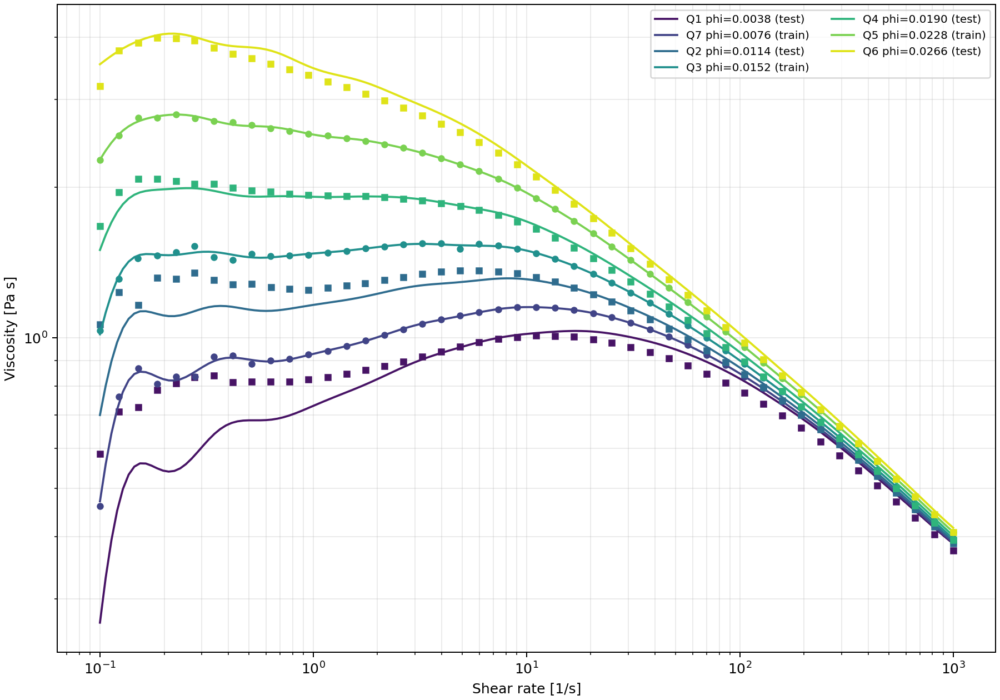

# 电池浆料微观流变–PBM–CFD耦合项目

## GitHub 核心版

本仓库只保留研究主线代码、已训练 Model C、Fluent 查表头文件和代表性验证结果。原始实验数据、汇报材料、临时输出、旧版 UDF 与重复压缩包保留在本地，不上传。

上传操作见 [VS Code 详细步骤](docs/GITHUB_VSCODE.md)，数据要求见 [数据说明](data/README.md)。下面的完整目录包含本地工作文件，GitHub 核心版不包含其中的 `data/raw`、`data/processed`、`notebooks`、`reports`、`udf/legacy`。

无需原始数据即可使用可信的 `artifacts/model_c/model_c.pkl` 预测，或重新导出 Fluent 离散表：

```powershell
conda activate ml
python -m src.export.fluent_table
python -m src.export.validate_fluent_table
python -m unittest discover -s tests -v
```

下文完整训练流程需要先在本地补齐 Q1–Q7 原始曲线。生成的 CSV/NPZ 与本地原始数据继续被忽略；核心版保留唯一的 C 表头用于 Fluent 编译。

当前保存的测试集 MAPE 为 2.40%–9.46%；已有离散表检查在 40 个随机点上的最大乘性误差约 0.3425%，仅反映该次抽样，不是全域误差上界。实验对比图见下：



Mixture-PBM 工程入口为 [model_c_pbm_final.c](udf/model_c_pbm_final.c)，设置及适用边界见 [FINAL_SETUP.md](udf/FINAL_SETUP.md)。不要将它和基础查表版混合挂接；本次仓库整理没有重新验证 Fluent 算例。

本项目保存从实验流变数据到 Fluent 黏度UDF的完整可重复流程：

```text
实验配方与流变曲线
  → 微观物理流变模型（DLVO与团聚结构）
  → 标定 Df、k_phi + GPR残差修正（Model C）
  → eta(phi_CB, shear rate) 对数响应面
  → 自动生成C头文件
  → Fluent UDF双线性插值
  → PBM结构 → 有效CB浓度 → 局部黏度 → 流场
```

## 目录

```text
project/
├── configs/                  # 材料、训练和Fluent表格配置
├── data/
│   ├── raw/rheology/         # 原始Q1–Q7流变曲线
│   ├── processed/            # 辅助拟合结果
│   └── formulations.csv      # 样品、CB浓度及训练/测试划分
├── src/
│   ├── data/                 # 数据加载与校验
│   ├── models/               # 微观流变、Model C、sectional PBM
│   ├── train/                # 训练与评估
│   ├── export/               # Fluent表格及C头文件导出
│   └── utils/                # 通用指标
├── notebooks/                # 探索性分析
├── tests/                    # 守恒、趋势和插值测试
├── udf/
│   ├── model_c_viscosity_udf.c
│   ├── pbm_aggregation_udf.c
│   ├── generated/            # 自动生成的Model C表格头文件
│   └── legacy/               # 原始UDF，仅用于追溯
├── artifacts/                # 模型、指标和Fluent响应面
├── reports/figures/          # 图件
├── scripts/run_pipeline.ps1  # 一键执行
└── requirements.txt
```

## 数据映射

原始文件名顺序不代表CB浓度顺序。映射记录在 `configs/model_c.json` 和 `data/formulations.csv`：

- 训练：Q7、Q3、Q5，对应 `phi_CB=0.0076, 0.0152, 0.0228`；
- 测试：Q1、Q2、Q4、Q6，覆盖低端外推、区间插值和高端外推。

原始黏度单位为mPa·s，加载时统一转换为Pa·s。

## 环境和运行

```powershell
conda activate ml
pip install -r requirements.txt
./scripts/run_pipeline.ps1
```

也可分步运行：

```powershell
python -m src.train.train_model_c
python -m src.export.fluent_table
python -m unittest discover -s tests -v
```

主要产物：

- `artifacts/model_c/model_c.pkl`：Python完整模型；
- `artifacts/model_c/model_c_metadata.json`：标定参数和GPR核；
- `artifacts/model_c/validation_metrics.csv`：逐配方指标；
- `artifacts/model_c/model_c_validation.png`：实验与预测对比；
- `artifacts/fluent_table/model_c_table.csv/.npz`：离散响应面；
- `artifacts/fluent_table/validation.json`：离散表相对原始Model C的插值误差；
- `udf/generated/model_c_table.h`：Fluent编译使用的嵌入式表格。

## Fluent中的本构

离线模型为：

```math
\log_{10}\eta_C
=\log_{10}\eta_{physics}(\dot\gamma,\phi_{CB};D_f,k_\phi)
+\Delta_{GPR}(\phi_{CB},\log_{10}\dot\gamma).
```

Python在规则网格上计算该模型；UDF在 `phi_CB` 与 `log10(shear rate)` 上对 `log10(eta)` 双线性插值，从而避免在每个Fluent网格及迭代步中运行非线性根求解和GPR。

PBM耦合采用：

```math
\phi_{CB,eff}=\phi_{CB}\,F_{struct}/F_{struct,ref}.
```

第一阶段令结构比为1，验证Model C–CFD接口；第二阶段由PBM粒径分布计算结构比，形成双向耦合。固定、已标定的 `Df` 用于粒径分布到有效占据体积的映射；当前版本不额外输运动态 `Df`。

## 复现边界

- `src/models/sectional_pbm.py` 是Bałdyga模型的零维机理复现，不等同于Fluent内置PBM。
- 正式聚集核假设Fluent传入的 `d_1,d_2` 是物理直径，使用前必须核对内部坐标和单位。
- `UDM 0/1` 的填充取决于具体多相线程和PBM设置，因此保留为明确接口，不能在不了解case的情况下猜测相索引。
- 响应面范围外采用边界钳制。正式计算应统计钳制网格比例；若不可忽略，应扩大范围重新导出。
